<div align="center">

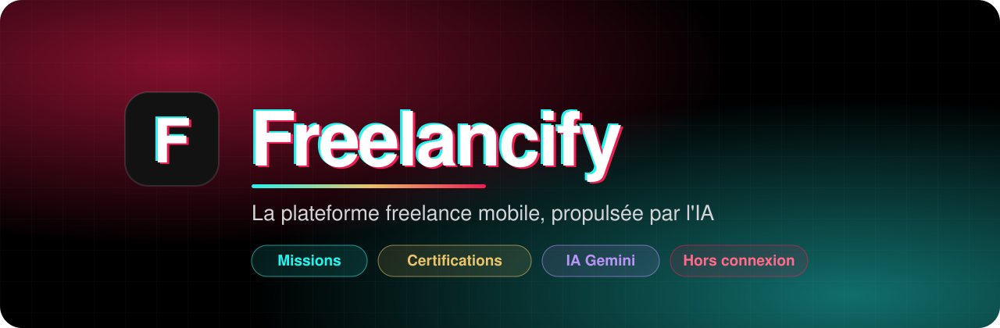

<br>

### Des missions, des talents certifiés et l'IA, dans une seule app mobile

Les **clients** publient leurs missions (ou les décrivent simplement à l'IA), les **freelancers**
prouvent leurs compétences par un test chronométré, obtiennent une **certification PDF**
et postulent. Une fois le compte créé, tout fonctionne **hors connexion** ; l'IA s'active dès qu'il y a du réseau.

<br>


<br>

[Fonctionnalités](#-fonctionnalités) •
[Captures](#-captures-décran) •
[IA](#-lintelligence-artificielle) •
[Architecture](#%EF%B8%8F-architecture) •
[Installation](#-installation) •
[Tests](#-tests) •
[Sécurité](#-sécurité)

</div>

---

## ✨ Fonctionnalités

<table>
<tr>
<td width="50%" valign="top">

### 💼 Côté client

- 📝 **Publier une mission** : titre, description, **jusqu'à 3 catégories**, budget fixe ou à l'heure, date limite, à distance / sur place / hybride, ville, compétences, badge *Urgent*
- ✨ **Remplir avec l'IA** : le client décrit son besoin en une phrase, l'IA remplit le formulaire (et laisse vide ce qui n'a pas été dit)
- 📥 **Gérer les candidatures** : accepter, refuser, discuter
- 📧 **Email automatique** à chaque nouvelle candidature
- 👥 Voir ses **abonnés** et ses recrutements

</td>
<td width="50%" valign="top">

### 🧑‍💻 Côté freelancer

- 🔎 **Fil des missions** : budget, délai, mode de travail, badge urgent
- 🏅 **Test de compétences** : 10 questions chronométrées, **3 tentatives** max
- 📜 **Certification PDF** téléchargeable, visible par les clients
- 🧠 **Rapport de l'IA** : points forts, points à améliorer, conseils
- 🔔 **Suivre des clients** et être notifié de leurs nouvelles missions
- 🖼️ **Portfolio** de réalisations et profil public

</td>
</tr>
<tr>
<td colspan="2" valign="top">

### 🌍 Pour tout le monde

| | Fonctionnalité | Détail |
|:-:|---|---|
| 💬 | **Messagerie** | Une discussion par candidature, entre client et freelancer |
| 🤖 | **Assistant IA** | Un chatbot qui connaît l'app et répond en 1 à 3 phrases, selon ton rôle |
| ✉️ | **Email vérifié** | À l'inscription, client ou freelancer : le compte n'est créé qu'après la saisie d'un code reçu par email |
| 🔑 | **Mot de passe oublié** | Code à 6 chiffres envoyé par email, valable 15 min, 5 essais |
| 👤 | **Profil soigné** | Carte d'identité, statistiques, « Complète ton profil », déconnexion confirmée |
| 📴 | **Hors connexion** | Missions, messages, tests : tout est stocké sur le téléphone (SQLite). Seules l'inscription, l'IA et les emails demandent Internet |
| 🎬 | **Ouverture animée** | Logo natif dès le lancement, puis animation jusqu'à ce que l'app soit prête |
| 📱 | **Petits écrans** | Interface vérifiée jusqu'à 320 dp de large, thème sombre |

</td>
</tr>
</table>

---

## 📸 Captures d'écran

<div align="center">

<table>
<tr>
<td align="center" width="33%">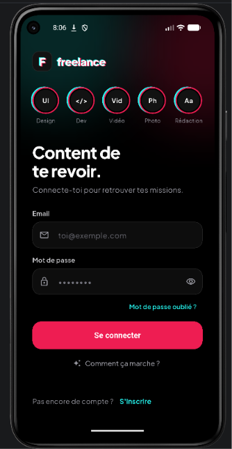<br><b>Connexion</b><br><sub>Accès rapide, mot de passe oublié, aide</sub></td>
<td align="center" width="33%">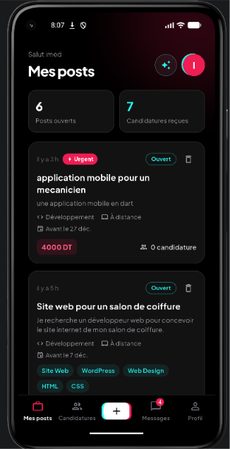<br><b>Mes posts</b><br><sub>Le tableau de bord du client</sub></td>
<td align="center" width="33%">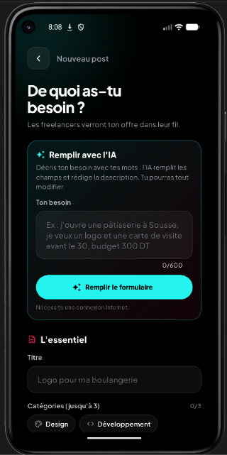<br><b>Publier avec l'IA</b><br><sub>Une phrase suffit pour remplir le formulaire</sub></td>
</tr>
<tr>
<td align="center" width="33%">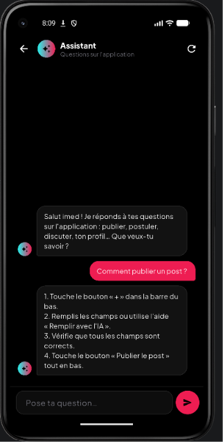<br><b>Assistant IA</b><br><sub>Des réponses courtes, selon ton rôle</sub></td>
<td align="center" width="33%">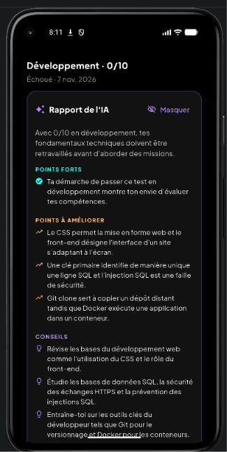<br><b>Rapport de l'IA</b><br><sub>Points forts, à améliorer, conseils</sub></td>
<td align="center" width="33%">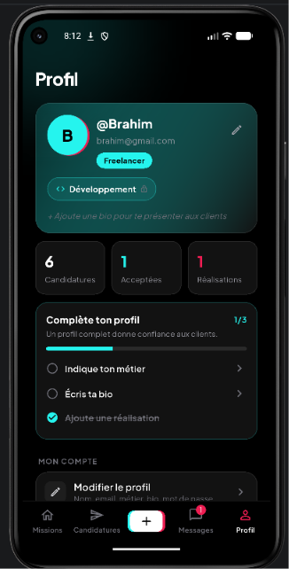<br><b>Profil</b><br><sub>Statistiques, domaines fixés, profil à compléter</sub></td>
</tr>
</table>

</div>

---

## 🧠 L'intelligence artificielle

Trois usages de **Google Gemini**, chacun avec **sa propre clé API** (quotas et suivi séparés) :

| | Fonction | Modèle | Ce qu'elle fait |
|:-:|---|---|---|
| 🤖 | **Assistant** | `gemini-3.5-flash-lite` | Explique l'app à partir d'un guide intégré ; réponses courtes, sans rien inventer, adaptées au rôle |
| ✍️ | **Remplir un post** | `gemini-3.6-flash` | Comprend une demande libre (français, derja, anglais) et renvoie un **JSON imposé par un schéma** |
| 📊 | **Rapport de test** | `gemini-3.6-flash` | Analyse les 10 réponses et rédige un rapport : synthèse, points forts, points faibles, conseils |

<details>
<summary><b>🛡️ Comment l'IA reste fiable</b></summary>

<br>

- **Sorties JSON structurées** (`responseJsonSchema`) : l'app ne lit jamais du texte libre pour remplir un formulaire.
- **Revalidation** : chaque valeur proposée passe par les mêmes validateurs que la saisie manuelle (catégories, budget, dates, longueurs).
- **Faits jamais devinés** : budget, date, ville et mode de travail ne sont remplis que s'ils sont dits ; le reste est signalé « à compléter ».
- **Rapport ancré dans les données** : l'IA ne reçoit que les questions, les réponses données et les bonnes réponses ; elle nomme les notions, pas « la question 3 ».
- **Robustesse** : nouveaux essais automatiques si Gemini est surchargé, puis modèle de secours ; messages clairs hors connexion ou quota atteint.
- **Rapport enregistré** : généré une seule fois, puis consultable hors connexion. Il est **privé** (invisible pour les clients).

</details>

---

## 🏅 Tests de compétences et certification

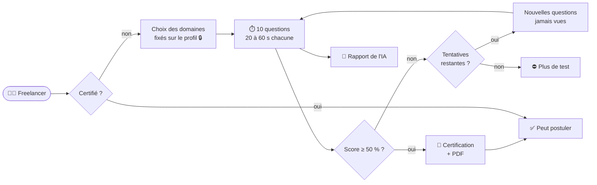

- **140 questions** (20 par domaine : Design, Développement, Vidéo, Photo, Rédaction, Marketing, Traduction), choix mélangés à chaque affichage.
- **Chronomètre par question** : temps écoulé = question fausse, passage automatique. Pas de retour en arrière.
- **Tentative supplémentaire** : après 3 échecs, un formulaire contrôlé (motif, explication, révisions, heures, engagement) accorde une dernière tentative, une seule fois ; la demande reste consultable avec son statut.
- **3 tentatives** au total ; une tentative compte dès le début (abandonner ne la rend pas). Un test réussi ne se repasse pas.
- Correction calculée **depuis la base**, enregistrée dans une transaction.
- **Certificat** : nom, métier, domaines, compétences validées, score, mention (*Passable → Excellent*), date et numéro unique `FRL-2026-XXXXXX`. Téléchargeable en **PDF** (dossier *Téléchargements*) ou partageable.
- Sans certification, **« Postuler » est bloqué** et propose de passer le test.

---

## 🏗️ Architecture

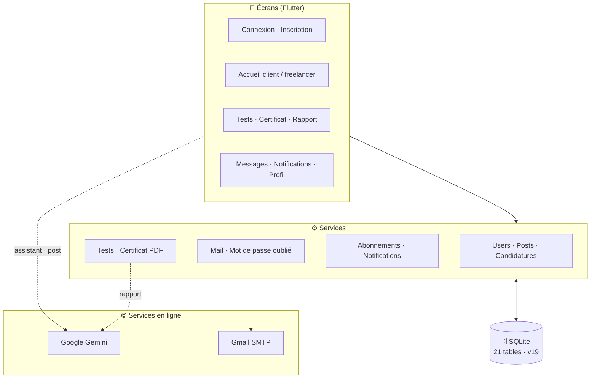

<details>
<summary><b>🔔 Le design pattern Observer (notifications)</b></summary>

<br>

Quand un client publie une mission, les freelancers qui le suivent sont notifiés. `PostService` ne
connaît pas les notifications : il **publie un événement**, et les observateurs réagissent.

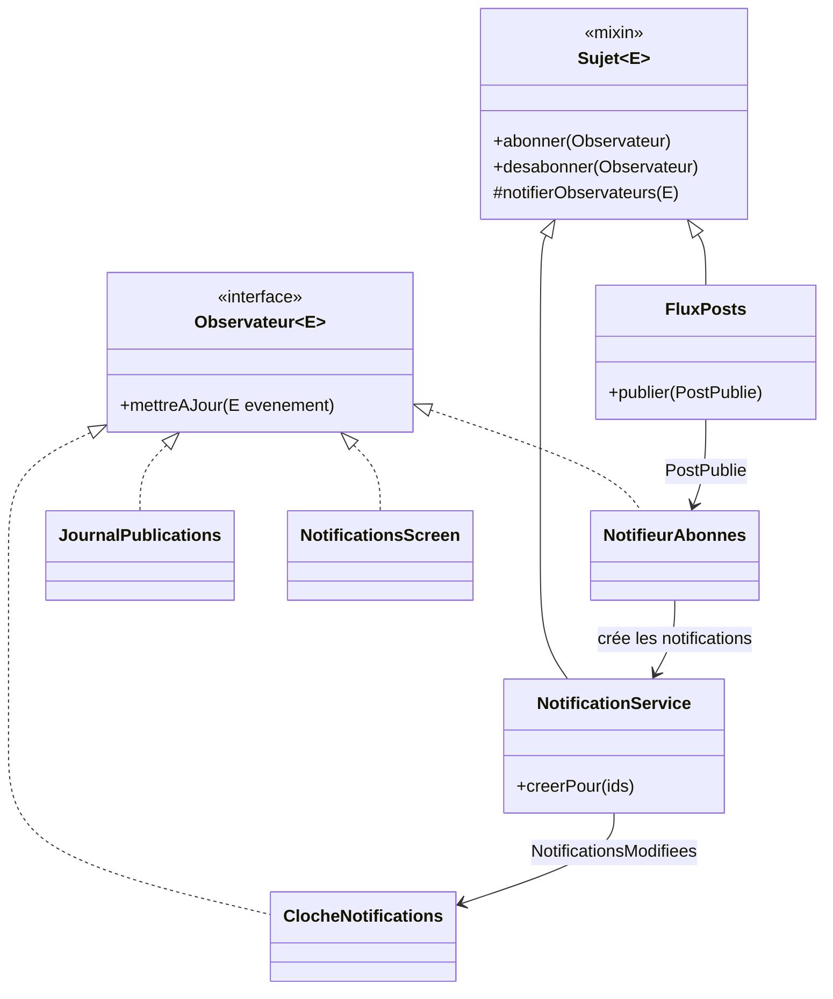

- **Deux sujets** : `FluxPosts` (une mission est publiée) et `NotificationService` (les notifications ont changé).
- **Observateurs** : `NotifieurAbonnes` crée les notifications, `JournalPublications` écrit un log, et la cloche (avec son badge) ainsi que l'écran des notifications se mettent à jour tout seuls.
- Les widgets s'abonnent dans `initState` et se désabonnent dans `dispose` (pas de fuite mémoire). Une erreur dans un observateur ne bloque pas les autres.

</details>

<details>
<summary><b>🗄️ Base de données (SQLite, version 19)</b></summary>

<br>

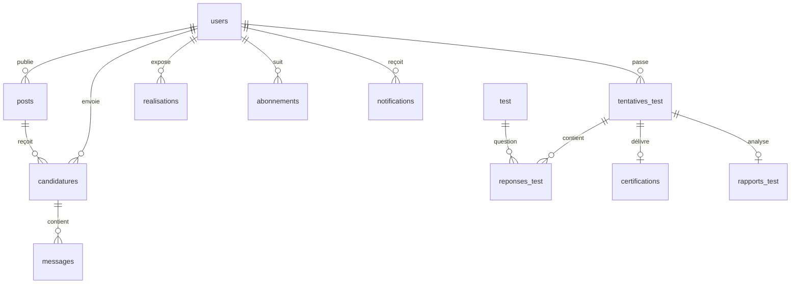

| Table | Rôle |
|---|---|
| `users` | Comptes (mot de passe haché), métier, bio, domaines fixés |
| `posts` · `candidatures` · `messages` | Missions, candidatures et discussions |
| `realisations` | Portfolio des freelancers |
| `abonnements` · `notifications` | Suivi des clients et notifications (Observer) |
| `test` | Banque de 140 questions, avec la durée de chacune |
| `tentatives_test` · `reponses_test` | Tests passés et réponses données |
| `demandes_tentative` | Demandes de tentative supplémentaire après 3 échecs |
| `projects` · `project_tasks` · `project_comments` · `project_activity` · `project_rewards` | Gestion des projets, tâches et CofeeCoins |
| `certifications` · `rapports_test` | Certificats délivrés et rapports de l'IA |
| `emails_sortants` · `codes_reinitialisation` · `verifications_email` | File d'envoi des emails (5 essais) et codes temporaires |

Les **migrations** font passer une ancienne installation à la version 19 **sans perdre de données**.

</details>

---

## 🚀 Installation

### Prérequis

| Outil | Version | Lien |
|---|---|---|
|  | 3.47 ou plus (Dart 3.13) | [flutter.dev](https://docs.flutter.dev/get-started/install) |
|  | avec un émulateur ou un téléphone Android | [developer.android.com](https://developer.android.com/studio) |
|  | gratuites (facultatif) | [aistudio.google.com/apikey](https://aistudio.google.com/apikey) |
|  | **nécessaire pour créer un compte** | [myaccount.google.com/apppasswords](https://myaccount.google.com/apppasswords) |

### 1️⃣ Cloner le dépôt

```bash
git clone https://github.com/BrahimGarram/Freelancify-mobile-2026-2027.git
cd Freelancify-mobile-2026-2027
flutter pub get
```

### 2️⃣ Configurer les secrets

Copie le modèle puis remplis-le. Ce fichier **n'est jamais envoyé sur GitHub** :

```bash
cp secrets.example.json assets/config/secrets.json
```

```json
{
  "GEMINI_CHAT_KEY": "clé de l'assistant",
  "GEMINI_POST_KEY": "clé du remplissage des posts",
  "GEMINI_RAPPORT_KEY": "clé du rapport des tests",
  "GMAIL_USER": "ton.adresse@gmail.com",
  "GMAIL_APP_PASSWORD": "mot de passe d'application (16 caractères)"
}
```

> ⚠️ `GMAIL_USER` et `GMAIL_APP_PASSWORD` sont indispensables pour **créer un compte** (code de vérification par email). Sans clés Gemini, seule l'IA est désactivée.
> Au démarrage, le terminal affiche l'état de chaque clé (`[IA] … clé OK`, `[MAIL] Emails ACTIVÉS`).

### 3️⃣ Lancer l'application

```bash
flutter run
```

> 🔁 Après avoir modifié `secrets.json`, fais un **redémarrage complet** (pas un *hot reload*).

---

## 🧪 Tests

```bash
flutter test      # 137 tests
flutter analyze   # 0 problème
```

| Fichier | Ce qui est vérifié |
|---|---|
| `test_competences_test.dart` | Quiz, questions jamais répétées, domaines fixés, durées, certification, PDF |
| `rapport_tentatives_test.dart` | 3 tentatives, abandon, double correction, rapport IA, nouveaux essais Gemini |
| `test_competences_ecrans_test.dart` | Parcours complet à 432 et 320 dp, chronomètre, blocage de « Postuler » |
| `ia_test.dart` | Assistant et remplissage des posts (API Gemini simulée) |
| `observer_test.dart` | Abonnement, notification des abonnés, cloche |
| `mail_test.dart` · `mot_de_passe_oublie_test.dart` · `verification_email_test.dart` | Emails, file d'envoi, codes de réinitialisation et de vérification |
| … | Validateurs, messagerie, portfolio, profil, publication |

Les tests utilisent une **base SQLite en mémoire** et des **faux clients HTTP** : aucun appel réseau.

---

## 📁 Structure du projet

```
lib/
├── main.dart                 # démarrage : secrets, observateurs, app
├── database/
│   ├── database_helper.dart  # 21 tables, migrations v1 → v19
│   └── questions_test.dart   # banque de 140 questions
├── models/                   # User, Post, Candidature, Quiz, Certification…
├── observer/                 # pattern Observer : Sujet, Observateur, FluxPosts
├── services/
│   ├── ai/                   # client Gemini, assistant, post, rapport de test
│   ├── mail/                 # Gmail SMTP, modèles d'email, file d'envoi
│   ├── test_service.dart     # quiz, correction, tentatives, certification
│   ├── certificat_pdf.dart   # génération et téléchargement du PDF
│   └── …                     # users, posts, candidatures, messages, abonnements
├── screens/
│   ├── client/ · freelancer/ # accueils et publication
│   ├── tests/                # domaines, quiz, résultat, certificat, rapport IA
│   ├── assistant/ · messages/
│   └── …                     # connexion, inscription, profil, notifications
├── theme/ · utils/ · widgets/
test/                         # 137 tests (unitaires et widgets)
assets/config/                # secrets.json (non versionné)
screenshots/                  # captures d'écran du README
```

---

## 🔒 Sécurité

- 🔐 **Mots de passe hachés** avec sel, jamais stockés en clair ; codes de réinitialisation hachés eux aussi.
- 🗝️ **Aucune clé dans le code** : elles sont lues dans `assets/config/secrets.json`, ignoré par git.
- ⚠️ Les secrets sont inclus dans l'APK généré : **ne publie pas l'APK** d'un build contenant tes clés.
- 🧾 Contrôle de saisie partout (validateurs communs à l'écran, à l'IA et aux services).
- 🙈 Le rapport de l'IA est **privé** ; les clients ne voient que la certification.
- 🧱 Requêtes SQL paramétrées et transactions pour les opérations sensibles.

---

<div align="center">

Réalisé par **[Mohamed Brahim Garram](https://github.com/BrahimGarram)**

<sub>Projet mobile · 2026-2027</sub>

</div>
